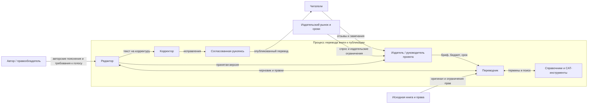

# Лабораторная работа 1. Границы и цель системы

**Тема:** перевод книг с сохранением стиля

## Записка о системе

**Система.** Рассматривается существующий процесс подготовки перевода книги к публикации: издатель или руководитель проекта передаёт переводчику исходный текст и требования, переводчик создаёт и уточняет перевод, редактор согласует его с переводчиком, затем корректор и издательство готовят рукопись к выпуску. Система существует, чтобы выпустить полный, точный и естественно читающийся перевод, который сохраняет узнаваемые особенности авторского стиля и укладывается в согласованные сроки и бюджет. Это описание процесса «как есть», а не проект нового сервиса.

**Граница.** Внутри — работа переводчика, редакторские согласования, корректура, управление версиями рукописи, рабочие договорённости и используемые справочники или CAT-инструменты. Снаружи, но влияет, — автор и правообладатель, исходная книга, издательский рынок и читатели: они задают исходный материал, ограничения и ожидания. Спорная граница — автор: он не выполняет переводческую работу, поэтому находится вне процесса, но его комментарии и требования к голосу могут менять решения внутри него. Словари и CAT-инструменты считаются рабочими средствами процесса, а не отдельными системами с собственной целью. Не относятся к рассматриваемой системе, например, личные дела участников и продвижение книги после передачи готовой рукописи в маркетинг.

**Цель и признаки достижения.** Книга готова к публикации, когда издательство принимает полный перевод, в нём нет неисправленных смысловых ошибок и редакторских замечаний, а ключевые особенности голоса автора согласованы переводчиком и редактором. Достижение цели видно по принятой финальной рукописи, числу оставшихся критических замечаний (ноль), соблюдению срока и бюджета проекта, а после выпуска — по обращениям читателей и исправлениям, связанным с качеством перевода. Сохранение стиля проверяется на заранее выбранных фрагментах и согласованных признаках голоса (например, регистр, ритм фраз, характерная лексика), а не только общим впечатлением.

## Контекстная диаграмма

## Заинтересованные стороны

| Сторона | Чего хочет | Где цель может расходиться с другими |
|---|---|---|
| Переводчик | Точно передать смысл и голос автора; иметь время на исследование и последовательные решения | Дополнительное время и свобода решений могут конфликтовать со сроком, бюджетом и редакторской унификацией |
| Редактор | Получить ясный, грамотный и цельный текст, соответствующий издательскому стилю | Нормализация текста может ослабить авторские особенности, которые переводчик старается сохранить |
| Издатель / руководитель проекта | Выпустить рукопись вовремя и в рамках бюджета, обеспечить качество и продажи | Срок и стоимость могут ограничивать число итераций и глубину стилистической работы |
| Автор / правообладатель | Сохранить смысл, тон и узнаваемый голос оригинала; соблюсти права | Буквальная близость оригиналу может спорить с естественностью перевода и читабельностью |
| Корректор | Устранить опечатки, грамматические и технические ошибки в финальной версии | Поздние содержательные правки могут возвращать текст на повторную вычитку и сдвигать выпуск |
| Читатель | Получить понятную, увлекательную книгу, которая звучит естественно на его языке | Ожидания аудитории могут отличаться от авторского голоса или издательского решения о степени адаптации |

## Три наблюдения из похода в систему

**Важно:** фактические заметки о походе не предоставлены. Ниже — гипотезы для проверки и замены реальными наблюдениями; не следует выдавать их за проведённое интервью или личный опыт.

1. **Гипотеза:** переводчик возвращается к ранее переведённым главам, когда позднее уточняет термин или голос персонажа. **Что может удивить:** стиль книги поддерживается не только при переводе отдельной фразы, но и постоянной сверкой решений на протяжении всей рукописи.
2. **Гипотеза:** редакторские замечания о «естественности» иногда конфликтуют с намеренно необычной речью автора. **Что может удивить:** улучшение гладкости текста не всегда улучшает сохранение авторского стиля; решение требует явного согласования, а не механического исправления.
3. **Гипотеза:** задержка ответа на спорный термин или авторский комментарий останавливает работу над несколькими связанными местами. **Что может удивить:** темп процесса зависит не только от скорости перевода, но и от доступности участников и своевременного принятия решений.

Перед сдачей замените эти три гипотезы фактами из собственного похода: что именно увидели или услышали и почему это оказалось неожиданным.